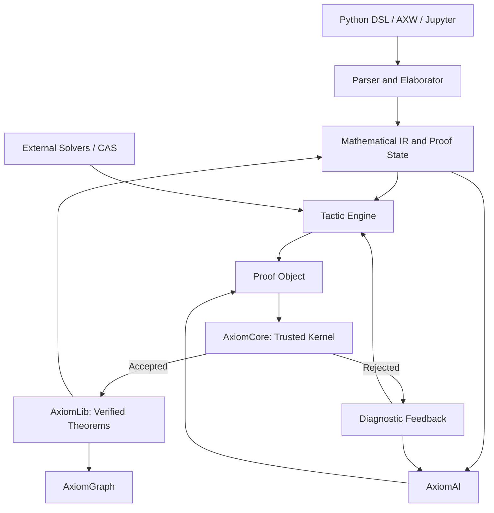
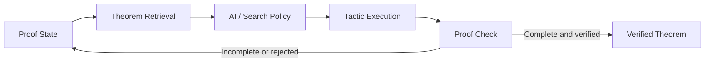

# AxiomWeave

**A Python-based Formal Mathematical Proof Language and AI-driven Theorem Proving Framework**

> 공리를 엮어 수학적 진리를 구성하다.  
> Weaving Axioms into Mathematical Truth.


> **개발 상태:** Pre-alpha. 직관주의 명제 논리(L0), 일차 술어 논리(L1), 등식(L2)의 검증 커널(AxiomCore), Python DSL(`Theory`, 증명 전술, L1의 종·상수·`ForAll`/`Exists`, L2의 `Eq`와 등식 전술), 표준 Theory(`classical`, 직관주의 명제 논리 정리 라이브러리 `propositional`), `axw check`/`axw verify` CLI가 구현되어 있다. 그 밖의 API, CLI 명령, 파일 구조 및 로드맵 항목은 목표 명세이며 구현 또는 배포 완료를 의미하지 않는다.

## 1. Overview

AxiomWeave(AXW)는 Python을 기반으로 수학적 정의, 공리, 명제, 정리 및 증명을 표현하고 검증하는 **형식적 수학 증명 언어**(Formal Mathematical Proof Language)이다.

Lean, Rocq, Isabelle 및 HOL Light 등의 정리 증명 시스템에서 영감을 받아 Python의 접근성과 확장성, 과학 계산 생태계, 인공지능 기술을 형식적 증명 시스템과 결합하는 것을 목표로 한다.

초기에는 Python 인터프리터를 수정하지 않는 임베디드 도메인 특화 언어(Embedded DSL)로 구현한다. 이후 필요에 따라 독립적인 `.axw` 문법 및 파서를 추가한다.

프로젝트의 개발 배경, 목표, 세부 개발 내용 및 추진 계획은 제안서 [docs/proposal.md](docs/proposal.md)에 정리되어 있다.

### Goals

- Python 문법을 활용한 수학적 명제 및 증명 표현
- 외부 증명기에 종속되지 않는 최소 증명 검증 커널 개발
- 명제 논리, 술어 논리, 기초 산술 및 대수학의 단계적 형식화
- 증명 전술, 정리 검색 및 검증 가능한 증명 객체 지원
- SymPy, Z3, cvc5, Lean 등 외부 시스템과의 상호운용성 확보
- LLM 및 탐색 알고리즘을 활용한 자동 증명과 수학적 추측 생성
- 증명 재현성, 공리 의존성 및 정리 간 의존 관계 추적

### Non-goals (v0.1)

- Lean/Mathlib 전체의 재구현 또는 완전한 호환
- 완전한 의존 타입 이론 및 고급 복소해석학 구현
- 모든 수학 문제를 해결하는 범용 자동 증명기
- 수치 계산, 외부 솔버의 성공 응답 또는 AI 출력을 검증 없이 증명으로 인정

## 2. Design Principles

| 원칙                   | 설명                                                           |
| ---------------------- | -------------------------------------------------------------- |
| Accessibility          | Python 개발자가 익숙한 방식으로 수학적 명제와 증명을 작성한다. |
| Soundness              | 명시된 논리 체계 및 공리 아래 커널이 검증한 증명만 인정한다.   |
| Minimal Trusted Kernel | 신뢰해야 하는 구현의 범위를 최소화한다.                        |
| Extensibility          | 수학 이론, 전술, 외부 백엔드를 확장할 수 있도록 한다.          |
| Reproducibility        | 증명 객체, 공리 및 환경 버전을 기록하여 재검증을 지원한다.     |
| AI-Native              | 자동 증명 탐색과 AI 학습을 위한 구조화된 증명 상태를 제공한다. |

## 3. Architecture



| 구성 요소   | 역할                                     |
| ----------- | ---------------------------------------- |
| AxiomWeave  | 수학 표현 및 증명 작성 언어              |
| AxiomCore   | 형식적 추론 규칙에 기반한 독립 검증 커널 |
| AxiomLib    | 검증된 수학 정의 및 정리 라이브러리      |
| AxiomAI     | AI 기반 증명 탐색 및 추측 생성           |
| AxiomGraph  | 정리 및 공리 의존성 그래프               |
| AxiomStudio | 향후 Jupyter 및 IDE 연계 환경            |
| AxiomHub    | 향후 검증된 정리의 공유 저장소           |

### Logical Foundations

논리 체계는 단순 타입 이론(Simple Type Theory)을 기반으로 설계하며, 최초 구현 및 검증 대상은 그 안의 직관주의 명제 논리 단편(L0)이다. 초기 커널은 자연 연역(Natural Deduction)으로 명제 원자, 논리곱, 논리합, 함의, 거짓 명제를 다루며, 부정(`Not(P) := Implies(P, Falsehood)`) 등 파생 연산자는 커널 입력 전에 원시 연산자로 전개한다. 상세 규칙은 [docs/logic-spec.md](docs/logic-spec.md)를 따른다.

이후 타입이 지정된 항, 전칭·존재 양화사, 등식 추론, 자연수 및 귀납 원리를 명시적인 규칙으로 추가한다. 고차 논리와 의존 타입은 별도의 논리 명세 및 검증을 거쳐 도입한다. 고전 논리 원리는 필요한 경우 명시적으로 등록하고 의존성을 추적한다.

## 4. Language Examples

> 4.1의 명제 논리 예제는 현재 구현(v0.1, L0)으로 실행할 수 있다. 일차 술어 논리(L1)와 등식(L2) 예제는 [examples/logic/first_order.py](examples/logic/first_order.py)와 [examples/logic/equality.py](examples/logic/equality.py)에 있다. 4.2와 4.3은 실수 이론 등 이후 단계의 **설계 예정 API** 예시이다. v0.1 API의 규범적 정의는 [docs/language-spec.md](docs/language-spec.md)를 따른다.

### 4.1. Propositional Logic

수학적 명제: $(P \to Q) \to (Q \to R) \to P \to R$

```python
from axiomweave import Prop, Theory, Implies

P, Q, R = (Prop.symbol(name) for name in ("P", "Q", "R"))
thy = Theory("demo.logic")


@thy.theorem
def implication_transitivity() -> Prop:
    return Implies(P >> Q, Q >> R, P >> R)


@thy.proof(implication_transitivity)
def prove_implication_transitivity(ctx):
    hpq = ctx.intro()
    hqr = ctx.intro()
    hp = ctx.intro()

    hq = ctx.mp(hpq, hp)
    hr = ctx.mp(hqr, hq)
    ctx.exact(hr)


report = thy.check()
```

정리와 증명은 명시적인 `Theory` 객체에 등록하며, 커널 검증은 `thy.check()`를 호출할 때 수행한다. `ctx.intro()`는 현재 목표의 함의 전제를 도입하고, `ctx.mp()`는 전건 긍정법(Modus Ponens)을 적용한다. `P`, `Q`, `R`은 구체적인 불리언 값이 아닌 추상적인 명제 원자이다. Python의 `>>`는 좌결합이므로 연쇄 함의는 `Implies(A, B, C)`로 작성한다.

### 4.2. Mathematical Expressions

수학적 명제: 모든 실수 $x$에 대해 $x^2 \ge 0$.

```python
from axiomweave import ForAll, Real, Symbol

x = Symbol("x", Real)
statement = ForAll(x, x**2 >= 0)
```

`statement`는 계산된 `bool` 값이 아닌 구조화된 명제이다. 실수 타입은 Python `float`와 구분하며, 수학적 상수는 정확한 표현을 사용한다. 실수 이론은 초기 커널 이후의 개발 범위이다.

### 4.3. Theorems and Tactics

```python
from axiomweave import Prop, Real, Theory
from axiomweave.lib.algebra import algebra, sq_nonneg

thy = Theory("demo.real", imports=[algebra])


@thy.theorem
def square_nonnegative(x: Real) -> Prop:
    return x**2 >= 0


@thy.proof(square_nonnegative)
def prove_square_nonnegative(ctx):
    x = ctx.intro()
    ctx.exact(sq_nonneg(x))
```

정리 선언의 수학적 매개변수는 전칭 양화된 변수로 해석한다. `sq_nonneg`는 사전에 검증된 라이브러리 정리여야 한다. 매개변수를 받는 정리와 전칭 정리의 적용 표기(`sq_nonneg(x)`)는 L1 이후 language-spec에서 정의할 잠정 표기이다.

### 4.4. Syntax Conventions

| 수학적 의미   | Python DSL                         | 도입 단편 |
| ------------- | ---------------------------------- | --------- |
| 거짓 / 참     | `Falsehood` / `Truth`              | L0 (v0.1) |
| 논리곱        | `And(P, Q)` 또는 `P & Q`           | L0 (v0.1) |
| 논리합        | `Or(P, Q)` 또는 `P \| Q`           | L0 (v0.1) |
| 부정          | `Not(P)` 또는 `~P`                 | L0 (v0.1) |
| 함의          | `Implies(P, Q, …)` 또는 `P >> Q`   | L0 (v0.1) |
| 동치          | `Iff(P, Q)`                        | L0 (v0.1) |
| 전칭 양화     | `ForAll(x, P(x))`                  | L1        |
| 존재 양화     | `Exists(x, P(x))`                  | L1        |
| 등식          | `Eq(x, y)`                         | L2        |
| 소속 관계     | `Contains(A, x)`                   | 이후      |
| 정확한 유리수 | `Rational(1, 2)`                   | 이후      |

기호 명제에 대한 암묵적 `bool()` 변환, Python의 `and`, `or`, `not` 및 연쇄 비교를 허용하지 않는다. Python 연산자 우선순위가 논리 관례와 다르므로 `>>`를 연쇄하지 않고, 서로 다른 연산자를 섞을 때는 괄호를 사용한다. `Eq()`는 수학적 등식이며, `Prop` 객체의 `==`는 구조적 동일성 검사이다.

## 5. Installation and Development

### 5.1. Requirements

- Python 3.12 이상 (초기 제안 기준)
- [uv](https://docs.astral.sh/uv/)
- Git
- Windows, Linux 또는 macOS

### 5.2. Install uv

Windows (PowerShell):

```powershell
irm https://astral.sh/uv/install.ps1 | iex
```

Linux / macOS:

```bash
curl -LsSf https://astral.sh/uv/install.sh | sh
```

설치 스크립트는 공식 배포 주소를 확인한 후 실행한다. 설치 방법은 [uv 공식 문서](https://docs.astral.sh/uv/getting-started/installation/)를 참고한다.

```bash
uv --version
```

### 5.3. Initialize a New Project

저장소가 아직 생성되지 않은 경우에만 실행한다.

```bash
uv python install 3.12
uv init --lib --python 3.12 axiomweave
cd axiomweave
uv python pin 3.12
uv add --dev pytest pytest-cov hypothesis ruff mypy
uv lock
uv sync
```

`uv init --lib`는 패키지용 `src/` 레이아웃과 빌드 설정을 생성한다. 이미 `pyproject.toml`이 존재하는 저장소에서는 초기화하지 않고 동기화만 수행한다.

### 5.4. Work with an Existing Repository

저장소를 확보한 뒤 프로젝트 루트에서 실행한다. 공개 저장소 URL은 아직 확정하지 않았다.

```bash
uv sync --locked
uv run python --version
```

`--locked`는 커밋된 `uv.lock`을 변경하지 않고 일관성을 확인한다. 초기 잠금 파일이 없다면 유지보수자가 `uv lock`을 실행하고 생성된 파일을 커밋한다.

### 5.5. Dependency Management

```bash
# 개발 의존성 추가
uv add --dev pytest

# 선택적 외부 백엔드 추가 (해당 기능 구현 시)
uv add --optional symbolic sympy
uv add --optional smt z3-solver

# 선택적 기능 설치
uv sync --extra symbolic --extra smt

# 의존성 확인 및 갱신
uv tree
uv lock --upgrade
```

초기 AxiomCore는 가능한 한 Python 표준 라이브러리만 사용한다. 외부 솔버와 AI 라이브러리는 선택적 의존성으로 분리하며, 커널의 필수 신뢰 기반에 포함하지 않는다.

`pyproject.toml`, `uv.lock`, `.python-version`은 버전 관리에 포함하고 `.venv/`, 캐시 및 빌드 결과는 제외한다. 프로젝트 의존성은 `uv add` 및 `uv remove`로 관리한다.

### 5.6. Project Metadata

`pyproject.toml`의 주요 설정 예시(초기화 시 생성된 `[build-system]`은 유지):

```toml
[project]
name = "axiomweave"
version = "0.1.0.dev0"
description = "A Python-based formal mathematical proof language"
readme = "README.md"
requires-python = ">=3.12"
dependencies = []

[project.scripts]
axw = "axiomweave.cli:main"

[project.optional-dependencies]
symbolic = ["sympy"]
smt = ["z3-solver"]

[dependency-groups]
dev = ["pytest", "pytest-cov", "hypothesis", "ruff", "mypy"]

[tool.ruff]
line-length = 100
target-version = "py312"

[tool.pytest.ini_options]
testpaths = ["tests"]
```

CLI 진입점은 `src/axiomweave/cli.py`에 `main()`을 구현한 뒤 활성화한다. Python 버전 및 의존성 제약은 실제 호환성 테스트를 거쳐 확정한다.

## 6. Repository Structure

다음은 목표 저장소 구조이다. 초기 버전에서는 `core/`, `kernel/`, `tests/`부터 개발한다.

```text
axiomweave/
├── README.md
├── pyproject.toml
├── uv.lock
├── .python-version
├── .gitignore
├── src/
│   └── axiomweave/
│       ├── __init__.py
│       ├── cli.py
│       ├── core/                  # 수학 표현, 타입, 치환
│       │   ├── expressions.py
│       │   ├── types.py
│       │   └── substitution.py
│       ├── kernel/                # AxiomCore
│       │   ├── checker.py
│       │   ├── rules.py
│       │   ├── axioms.py
│       │   └── certificate.py
│       ├── language/              # DSL 및 elaborator
│       ├── tactics/               # 증명 전술
│       ├── lib/                   # AxiomLib
│       │   ├── logic/
│       │   ├── arithmetic/
│       │   └── algebra/
│       ├── backends/              # SymPy, Z3, cvc5, Lean
│       ├── ai/                    # AxiomAI
│       ├── knowledge/             # AxiomGraph
│       └── interfaces/            # Jupyter, LSP
├── tests/
│   ├── unit/
│   ├── integration/
│   └── soundness/
├── examples/
│   ├── logic/
│   └── arithmetic/
├── benchmarks/
└── docs/
    ├── proposal.md                # 프로젝트 제안서
    ├── specification.md           # 명세 개요 및 하위 명세 색인
    ├── logic-spec.md
    ├── language-spec.md
    └── kernel-spec.md
```

## 7. Proof Verification and Trust Model

AxiomWeave는 증명 탐색과 증명 검증을 구분한다. 전술, 외부 도구 또는 AI가 생성한 증명 객체는 AxiomCore가 독립적으로 검사한다.

커널은 다음을 검증하도록 설계한다.

- 증명 객체의 구조와 논리적 추론 규칙
- 명제, 타입 및 변수 범위의 일관성
- 전제 도입·해제, 치환 및 양화 규칙의 부수 조건
- 정리와 공리의 참조 및 의존성
- 목표 명제와 실제 도출된 명제의 일치
- 미완성 증명, 순환 참조 및 허용되지 않은 공리 사용 여부

```text
Candidate proof -> Kernel check -> Verified theorem OR rejection
```

커널 내부에서 임의 Python 코드, 플러그인 또는 외부 솔버를 호출하지 않는 것을 원칙으로 한다. 신뢰되지 않는 증명 데이터는 검증된 형식으로 파싱하고, 생성 환경과 검증 환경은 프로세스 수준에서 분리하는 것을 목표로 한다.

| 검증 상태(예정)     | 의미                                                      |
| ------------------- | --------------------------------------------------------- |
| `UNPROVEN`          | 명제 선언 또는 미완성 증명                                |
| `VERIFIED`          | 자체 커널이 허용된 공리 및 규칙 아래 검증                 |
| `EXTERNAL_VERIFIED` | 명시한 외부 검증 환경에서 검증되었으나 자체 검증은 미완료 |
| `REJECTED`          | 증명 객체 또는 추론 단계 검증 실패                        |

`VERIFIED`는 무조건적인 진리 보증이 아니라 사용된 논리 체계, 공리, 구현의 정확성에 상대적인 검증 결과이다. 검증 실패나 탐색 시간 초과는 명제가 거짓이라는 뜻이 아니다.

### External Backends

SymPy는 기호 연산, SMT 솔버는 추론 후보 및 인증서 생성, Lean은 지원되는 논리 범위의 교차 검증에 활용한다. 외부 도구의 성공 응답만으로 자체 정리를 승인하지 않는다. 인증서를 내부 증명 객체로 재구성하여 커널에서 검증할 수 있는 경우에만 `VERIFIED` 상태를 부여한다.

## 8. Command-Line Interface

다음 명령은 v0.1에 구현되어 있다.

```bash
uv run axw --help
uv run axw check examples/logic/implication.py   # 증명 코드를 실행하고 커널로 검증
uv run axw verify proof.axwp                     # 사용자 코드 없이 인증서만 커널로 재검증
uv run axw verify proof.axwp --allow NAME=HASH   # 표준 외 공리를 해시와 함께 허용
```

저장소 루트의 래퍼 스크립트로 `uv run` 없이 실행할 수 있다. 래퍼는 어느 디렉터리에서 호출해도 이 프로젝트 환경을 사용하며, 상대 경로는 현재 디렉터리 기준이다.

```bash
axw.bat check examples\logic\implication.py   # Windows (cmd, PowerShell)
./axw check examples/logic/implication.py      # Linux / macOS
```

인증서(`.axwp`)는 `thy.check()` 후 `thy.export(path)`로 만든다. 형식은 [docs/kernel-spec.md](docs/kernel-spec.md)를 따른다.

다음 명령은 구현 예정이다.

```bash
uv run axw prove examples/logic/implication.py
uv run axw axioms examples/logic/implication.py
uv run axw search "implication transitivity"
```

`.axw`는 향후 독립 DSL의 소스 파일 확장자이다.

## 9. AI-driven Theorem Proving

AxiomAI는 현재 목표와 가정, 사용 가능한 정리, 전술 실행 결과를 입력으로 하여 다음 추론 단계를 탐색한다.



초기에는 규칙 기반 탐색을 구현하고, 이후 LLM, RAG, MCTS 및 강화학습을 선택적으로 도입한다. AI의 추측과 증명 후보는 커널 검증 결과와 분리하여 관리한다.

## 10. Testing and Code Quality

다음 명령으로 검사한다.

```bash
# 단위 및 통합 테스트
uv run pytest

# 커널 및 전체 패키지 커버리지
uv run pytest --cov=axiomweave --cov-report=term-missing

# 린트 및 포맷
uv run ruff check .
uv run ruff format --check .

# 정적 타입 검사
uv run mypy src/axiomweave
```

테스트 전략은 정상 증명뿐 아니라 잘못된 증명의 거부를 중점적으로 다룬다. 잘못된 전제, 자유 변수 유출, 양화 규칙 위반, 순환 참조, 허용되지 않은 공리와 인증서 변조 등을 포함한다. Hypothesis 기반 속성 테스트 및 외부 증명 시스템과의 제한적 교차 검증도 추진한다.

테스트 통과와 코드 커버리지 자체는 커널의 논리적 건전성을 증명하지 않는다.

### Build

```bash
uv build
```

빌드 결과는 기본적으로 `dist/`에 생성된다. PyPI 배포는 패키지명 사용 가능 여부, 라이선스 및 릴리스 검증이 완료된 뒤 진행한다.

## 11. Roadmap

- [x] **M0 — Specification:** 논리 체계, 표현식 및 증명 객체 형식 명세
- [x] **M1 — AxiomCore:** 명제 논리 AST 및 최소 자연 연역 검증 커널
- [x] **M2 — AxiomWeave v0.1:** Python DSL, 기본 전술, 명제 논리 정리 라이브러리(`classical`, `propositional`) 및 CLI
- [ ] **M3 — Arithmetic:** 타입이 지정된 항, 양화사, 등식, 자연수 및 귀납법 (L1 일차 술어 논리 구현됨: [logic-spec §12](docs/logic-spec.md#12-단편-l1-일차-술어-논리), L2 등식 구현됨: [logic-spec §13](docs/logic-spec.md#13-단편-l2-등식), L3 자연수 명세 개정안 검토 중: [logic-spec §14](docs/logic-spec.md#14-단계-l3-자연수와-귀납-개정안))
- [ ] **M4 — Interoperability:** SymPy, SMT, Lean 연계와 검증 가능한 인증서 변환
- [ ] **M5 — AxiomAI:** 정리 검색, 자동 증명 탐색 및 벤치마크
- [ ] **M6 — Tooling:** Jupyter, IDE 및 증명 지식 그래프
- [ ] **Long-term:** 고차 논리, 의존 타입 및 고급 수학 라이브러리 연구

첫 번째 릴리스의 완료 기준은 명제 논리 증명 객체를 생성하고 독립적으로 재검증할 수 있으며, 사전에 정의한 잘못된 증명 테스트를 모두 거부하는 것이다. 실제 개발 범위와 일정은 초기 구현 결과에 따라 조정한다.

## 12. Contributing

기여를 시작할 때는 먼저 논리 명세와 검증 커널 설계를 확인한다.

1. 변경할 논리 규칙 또는 기능의 명세를 작성한다.
2. 정상 및 실패 사례에 대한 테스트를 추가한다.
3. 구현 후 `pytest`, `ruff`, `mypy` 검사를 수행한다.
4. 변경 이유, 공리 의존성 및 신뢰 기반에 미치는 영향을 문서화한다.

커널 추론 규칙, 공리 및 인증서 검증의 변경은 일반 전술 추가보다 엄격하게 검토한다. 검증 우회 기능이나 증명되지 않은 명제를 승인하는 구현은 허용하지 않는다.

## 13. References

- [Lean 4 — Theorem Proving in Lean](https://lean-lang.org/theorem_proving_in_lean4/)
- [Mathlib](https://github.com/leanprover-community/mathlib4)
- [Rocq](https://rocq-prover.org/)
- [Isabelle](https://isabelle.in.tum.de/)
- [HOL Light](https://github.com/jrh13/hol-light)
- [Knuckledragger](https://github.com/philzook58/knuckledragger)
- [Lean4Lean](https://github.com/digama0/lean4lean)
- [SymPy](https://www.sympy.org/)
- [Z3](https://github.com/Z3Prover/z3)
- [cvc5](https://cvc5.github.io/)
- [uv documentation](https://docs.astral.sh/uv/)
- [uv project management](https://docs.astral.sh/uv/guides/projects/)

## 14. License

오픈소스 공개를 지향한다. 구체적인 라이선스는 아직 확정하지 않았다. 후보는 Apache-2.0이며, 결정 후 루트에 `LICENSE` 파일을 추가한다. 라이선스 확정 전에는 재배포·수정 권한이 부여되었다고 간주하지 않는다.

---

**AxiomWeave — Weaving Axioms into Mathematical Truth.**
